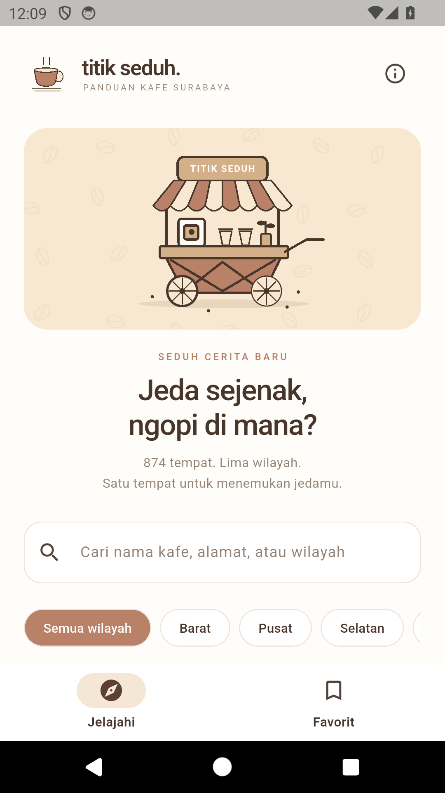
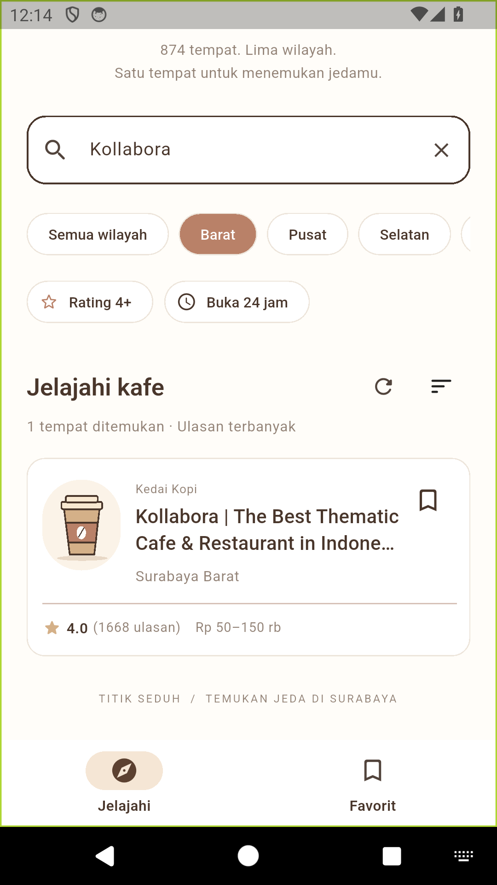
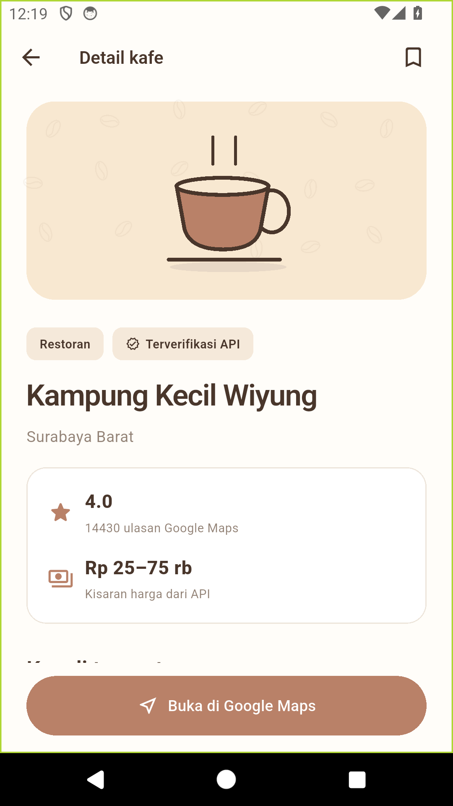
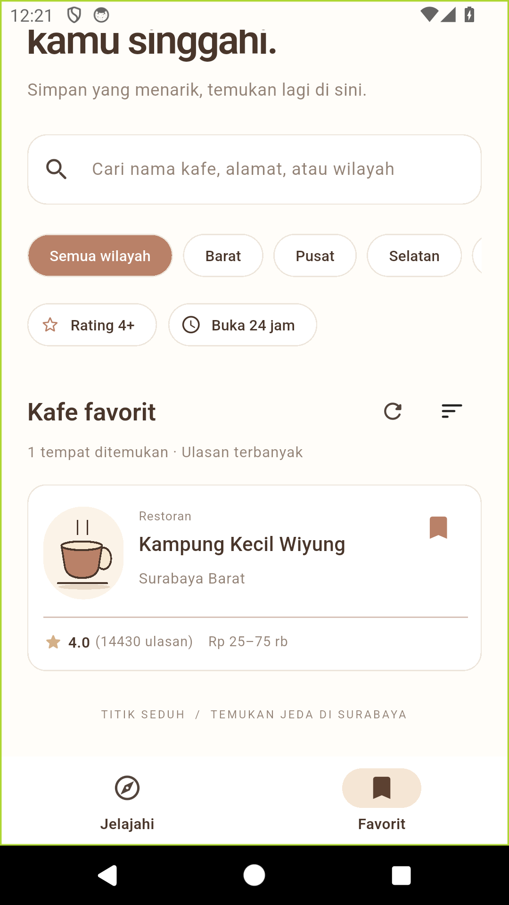

# Titik Seduh

Aplikasi Flutter untuk menemukan kafe di Surabaya melalui Surabaya Cafe API. Pengguna dapat menelusuri kafe, membandingkan informasi, menyimpan favorit, dan membuka lokasi melalui Google Maps.

## Fitur utama

- Daftar kafe dinamis dari API, menampilkan nama, kategori, wilayah, rating, jumlah ulasan, dan harga.
- Pencarian berdasarkan nama, alamat, wilayah, atau kategori tanpa mengirim ulang HTTP.
- Filter wilayah berdasarkan data API, rating minimal 4, serta informasi buka 24 jam.
- Pengurutan berdasarkan ulasan terbanyak, rating tertinggi, atau nama A–Z.
- Halaman detail berisi alamat, informasi jam, fasilitas, sumber dan tanggal verifikasi data.
- Favorit yang tersimpan secara lokal dan tetap tersedia setelah aplikasi ditutup. Data lengkap kafe tetap memerlukan internet.
- Tombol Google Maps menggunakan URL dari API atau koordinat sebagai cadangan.
- `FutureBuilder` menangani loading, sukses, respons kosong, dan error. Tersedia tombol coba lagi, muat ulang, serta tarik untuk memuat ulang.
- Layout ponsel dan grid pada layar lebar, termasuk dukungan ukuran teks besar.

## Tampilan

| Jelajahi | Pencarian | Detail | Favorit |
| --- | --- | --- | --- |
|  |  |  |  |

Tangkapan layar di atas berasal dari aplikasi Android pada emulator API 34 menggunakan data API yang sebenarnya. UI kartun memakai warna krem/cokelat dan ilustrasi gerobak serta cangkir kopi yang digambar langsung menggunakan CustomPainter. Ilustrasi bersifat dekoratif; API tidak menyediakan foto kafe.

## Teknologi dan package

| Teknologi | Versi project | Fungsi |
| --- | --- | --- |
| Flutter | Diuji pada 3.47.7 stable | GUI Material 3, navigasi, FutureBuilder |
| Dart | SDK ^3.13.5 | Model, Future, async/await, filter dan sort |
| http | ^1.6.0 | Permintaan HTTP GET dan pengujian MockClient |
| shared_preferences | ^2.5.6 | Penyimpanan ID favorit di perangkat |
| url_launcher | ^6.3.3 | Membuka Google Maps |
| flutter_test | Flutter SDK | Unit test dan widget test |
| flutter_lints | ^6.0.0 | Analisis kualitas kode |

Implementasi Android `shared_preferences_android` memakai versi **2.5.3** pada lockfile, yang memuat perbaikan startup build release. Hindari mengembalikan lockfile ke 2.5.0.

Versi dependency yang tepat disimpan dalam `pubspec.lock`. Tidak memerlukan API key, akun, atau backend tambahan.

## Menjalankan aplikasi

1. Pasang Flutter stable yang mendukung Dart 3.13.5 atau lebih baru, Android SDK, dan emulator/perangkat Android dengan USB debugging.
2. Unduh project dan jalankan:

```bash
git clone https://github.com/ikwfahmi/titik-seduh.git
cd titik-seduh
flutter doctor
flutter pub get
flutter devices
flutter run
```

Untuk menjalankan pada Chrome:

```bash
flutter run -d chrome
```

Aplikasi memerlukan koneksi internet untuk mengambil daftar kafe dan membuka peta. Izin `android.permission.INTERNET` sudah ditambahkan pada manifest utama, sehingga berlaku juga untuk build release.

## Build dan pengujian

```bash
flutter analyze
flutter test
dart run tool/check_api.dart
flutter build apk --debug
flutter build apk --release
flutter build web --no-web-resources-cdn
```

APK debug dihasilkan di `build/app/outputs/flutter-apk/app-debug.apk`; APK release di `build/app/outputs/flutter-apk/app-release.apk`. Build release masih memakai debug signing bawaan untuk pengembangan; siapkan signing key sendiri jika akan diterbitkan ke Play Store.

Hasil pengujian dan langkah reproduksi tersedia di [docs/PENGUJIAN.md](docs/PENGUJIAN.md).

## API dan alur data

Endpoint: [GET /api/cafes](https://surabaya-cafe-api.vercel.app/api/cafes).

```bash
curl https://surabaya-cafe-api.vercel.app/api/cafes
```

Respons berupa **array JSON langsung**, tanpa pembungkus `data`. Saat diperiksa pada 23 Oktober 2026, API mengembalikan 874 kafe pada lima wilayah Surabaya. Jumlah tersebut dapat berubah; aplikasi menghitung jumlah dari respons terbaru.

```text
Halaman dibuka / muat ulang
  → CafeService.fetchCafes()
  → HTTP GET, batas waktu 25 detik, pemeriksaan status 200
  → decode UTF-8 dan JSON
  → Cafe.fromJson() untuk setiap elemen
  → FutureBuilder<List<Cafe>>
  → filter dan pengurutan lokal
  → kartu kafe → halaman detail → Google Maps
```

`Future` dibuat di `initState` dan diganti hanya ketika pengguna memuat ulang. Pengetikan, filter, dan perubahan favorit tidak membuat permintaan HTTP tambahan. Penjelasan struktur model, contoh JSON, dan cara kerja aplikasi tersedia di [docs/IMPLEMENTASI.md](docs/IMPLEMENTASI.md).

## Struktur project

```text
.
├── lib/
│   ├── main.dart
│   ├── app.dart
│   ├── models/
│   │   ├── cafe.dart
│   │   └── cafe_query.dart
│   ├── services/
│   │   ├── cafe_service.dart
│   │   └── favorites_store.dart
│   ├── screens/
│   │   ├── home_screen.dart
│   │   └── cafe_detail_screen.dart
│   ├── widgets/
│   └── theme/
│       └── app_theme.dart
├── test/
├── docs/
├── assets/
│   └── branding/
├── android/
├── ios/
├── web/
├── pubspec.yaml
└── README.md
```

## Batasan data

- Jam operasional merupakan teks dari API, bukan status buka real time. Filter 24 jam hanya mencocokkan teks “24 jam” dan mengecualikan kafe berstatus tutup sementara.
- Fasilitas, deskripsi, harga, dan atribut lainnya dapat kosong. Aplikasi tidak mengarang informasi pengganti.
- Beberapa alamat dari API masih berupa kategori tempat. Aplikasi menampilkan data sumber dan menyediakan tautan peta untuk pemeriksaan lebih lanjut.
- Rating, status verifikasi, dan tanggal verifikasi mengikuti API; badge verifikasi bukan klaim verifikasi mandiri oleh pengembang.
- Favorit disimpan sebagai ID di perangkat/browser ini, tanpa sinkronisasi antarperangkat dan tanpa cache offline daftar kafe.

## Referensi

- [Flutter: mengambil data dari internet](https://docs.flutter.dev/cookbook/networking/fetch-data)
- [Flutter: FutureBuilder](https://api.flutter.dev/flutter/widgets/FutureBuilder-class.html)
- [Dart: asynchronous programming](https://dart.dev/libraries/async/async-await)
- [Package http](https://pub.dev/packages/http)
- [Package shared_preferences](https://pub.dev/packages/shared_preferences)
- [Package url_launcher](https://pub.dev/packages/url_launcher)
- [Surabaya Cafe API](https://surabaya-cafe-api.vercel.app/)
